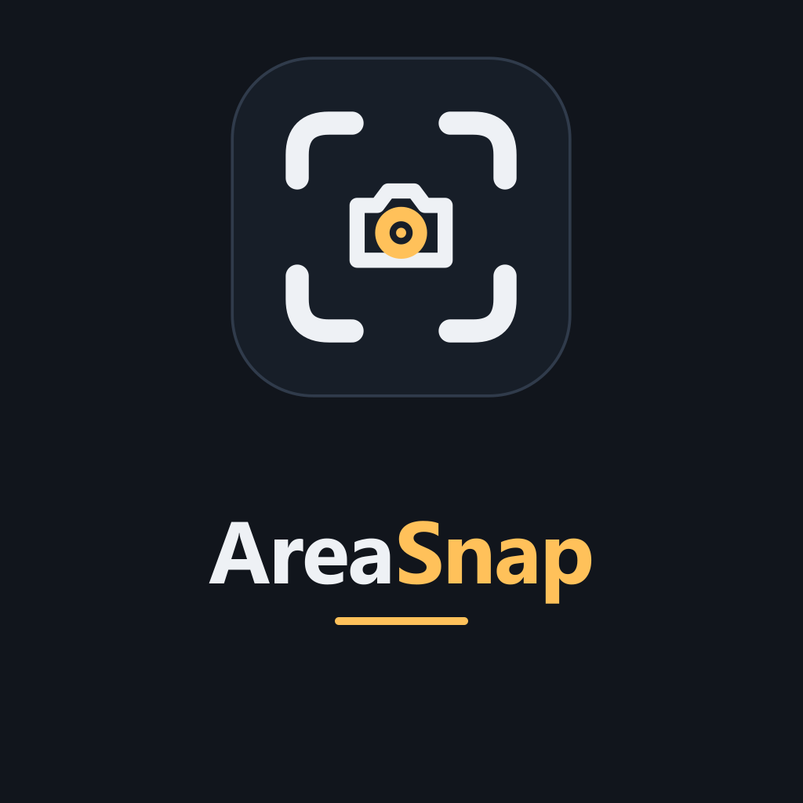

<p align="center">
  <picture>
    <source media="(prefers-color-scheme: dark)" srcset="assets/logo-dark.png">
    <source media="(prefers-color-scheme: light)" srcset="assets/logo.png">
    
  </picture>
</p>

<h1 align="center">Voryda Snap</h1>

<p align="center">
  <strong>Select an area. Capture it. Save or copy.</strong>
</p>

<p align="center">
  
  
  
  
  
</p>

<p align="center">
  <a href="#overview">Overview</a> ·
  <a href="#current-status">Status</a> ·
  <a href="#usage">Usage</a> ·
  <a href="#build">Build</a> ·
  <a href="#documentation">Docs</a> ·
  <a href="#privacy">Privacy</a>
</p>

## Overview

**Voryda Snap** is a small native screenshot utility for Windows. It is built around two capture paths that are usable today: selecting a rectangular region or capturing the primary display. The result can be copied to the clipboard, written to disk, or both.

The application is implemented in C# on .NET 8 with WinForms. It runs locally, stores its preferences in a JSON file under the current Windows profile, and does not require an account or online service.

## Current status

The repository declares version **1.0.0**. There is currently no GitHub Release published for this repository.

| Capability | State | Notes |
| --- | --- | --- |
| Region capture | **Implemented** | Drag a rectangle over the desktop and capture its physical screen bounds. |
| Primary-screen capture | **Implemented** | Captures the complete primary display. |
| Clipboard output | **Implemented** | Copies the resulting bitmap to the Windows clipboard. |
| File output | **Implemented** | PNG or JPEG. |
| JPEG quality | **Implemented** | Stored in settings; the default is 90. |
| Global shortcut | **Implemented** | <kbd>Ctrl</kbd>+<kbd>Shift</kbd>+<kbd>S</kbd>. |
| System tray | **Implemented** | Region capture, full-screen capture and exit actions. |
| Window capture engine | **Present** | The capture layer can capture a window handle through `PrintWindow`. |
| Window-selection workflow | **Not completed** | The current UI exposes the mode but does not yet select and capture a window. |
| GitHub Release | **Not published** | No release asset is currently available from GitHub Releases. |

## What it does

- Captures a user-selected rectangular region.
- Captures the complete primary display.
- Saves images as **PNG** or **JPEG**.
- Copies captures directly to the Windows clipboard.
- Can copy and save the same capture in one operation.
- Hides the main window before capturing to keep it out of the screenshot.
- Keeps capture mode, format, output folder and output preferences between sessions.
- Provides a tray menu and the global <kbd>Ctrl</kbd>+<kbd>Shift</kbd>+<kbd>S</kbd> shortcut.
- Shows the captured dimensions and, when saved, the filename and file size.

## Usage

1. Choose **Region** or **FullScreen**.
2. Select **PNG** or **JPG**.
3. Choose whether to copy to the clipboard, save to a file, or do both.
4. Set the destination folder when file output is enabled.
5. Press **Capture** or use <kbd>Ctrl</kbd>+<kbd>Shift</kbd>+<kbd>S</kbd>.
6. In Region mode, drag over the area to capture.

The default configuration uses Region mode, PNG output, clipboard copy and file saving.

## Local data

| Item | Location / default |
| --- | --- |
| Settings | `%APPDATA%\AreaSnap\settings.json` |
| Default image folder | `%USERPROFILE%\Pictures\AreaSnap` |
| Default filename template | `AreaSnap-{yyyyMMdd-HHmmss}` |
| Default format | PNG |
| Default JPEG quality | 90 |

The `AreaSnap` paths and internal project names are intentionally retained for compatibility while the public product name moves to **Voryda Snap**.

## Requirements

- Windows 10 version 2004 (build 19041) or later, or Windows 11.
- .NET 8 runtime for a framework-dependent build.
- .NET 8 SDK only when building from source.

## Architecture

| Project | Responsibility |
| --- | --- |
| `AreaSnap.App` | WinForms shell, persisted settings, tray integration and global shortcut. |
| `AreaSnap.Core` | Capture settings, output format and result models. |
| `AreaSnap.Capture` | Screen, region and window-handle capture implementation. |

The current capture implementation uses Windows desktop APIs through `System.Drawing`, `CopyFromScreen` and `PrintWindow`.

## Build

Clone the repository and build with the .NET 8 SDK:

```powershell
git clone https://github.com/smouj/voryda-snap
cd voryda-snap
dotnet build -c Release
```

Run the application project:

```powershell
dotnet run --project src\AreaSnap.App\AreaSnap.App.csproj
```

Create a self-contained Windows x64 build:

```powershell
dotnet publish src\AreaSnap.App -c Release -r win-x64 --self-contained
```

## Documentation

This repository keeps its product and developer guidance in this README; no separate docs tree is maintained.

## Privacy

Voryda Snap does not need an account, cloud storage or a remote API for its capture workflow. Captures are copied to the local clipboard and/or written to the folder selected by the user. Application settings remain in the local Windows profile.

## License

The source code is distributed under the **MIT License**. See [LICENSE](LICENSE).

---

<p align="center">
  <strong>Voryda</strong><br>
  Focused Windows utilities.
</p>

<p align="center">
  <a href="https://github.com/smouj/voryda-snap">Snap</a>
  ·
  <a href="https://github.com/smouj/voryda-rec">Rec</a>
  ·
  <a href="https://github.com/smouj/voryda-down">Down</a>
  ·
  <a href="https://github.com/smouj/voryda-cut">Cut</a>
</p>
