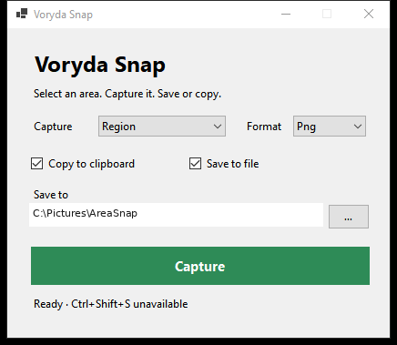

  <picture>
    <source media="(prefers-color-scheme: dark)" srcset="https://raw.githubusercontent.com/smouj/voryda-snap/main/assets/logo-dark.png?v=e7158076109eeb15cc99427d45acea1df2a7448f3a02f824ce942681ba18fdce">
    <source media="(prefers-color-scheme: light)" srcset="https://raw.githubusercontent.com/smouj/voryda-snap/main/assets/logo.png?v=e7158076109eeb15cc99427d45acea1df2a7448f3a02f824ce942681ba18fdce">
    
  </picture>

<h1 align="center">Voryda Snap</h1>

  <strong>Capture a region, the primary display or a window.</strong>

  
  
  
  

  <a href="#overview">Overview</a> ·
  <a href="#features">Features</a> ·
  <a href="#project-status">Status</a> ·
  <a href="#build-from-source">Build</a> ·
  <a href="#privacy">Privacy</a>

## Overview

**Voryda Snap** is a lightweight Windows screenshot utility written in C# with .NET 8 and Windows Forms. Capture a selected rectangle, the primary display, or a window, then copy the image to the clipboard, save it, or do both.

The app uses Windows desktop capture APIs locally. It does not require an account or a remote service. The current workflow is for capture and output; it does not include an image annotation editor.

## Features

- Capture a user-selected rectangular region.
- Capture the primary display or choose a visible window from the picker.
- Save images as PNG or JPEG, with a configurable JPEG quality.
- Copy an image to the Windows clipboard, save it to disk, or do both.
- Use <kbd>Ctrl</kbd>+<kbd>Shift</kbd>+<kbd>S</kbd> to start the configured capture.
- Restore capture preferences and output folder from local settings.
- Use the system tray menu to restore the app, capture a region or the full screen, or exit.

Window capture uses the Windows <code>PrintWindow</code> API. The result depends on how the target application renders its window; some windows may not provide a complete capture.

## Project status

The project metadata declares version **1.0.0**, but there is no public GitHub Release or release download at this time. Build the application from source using the instructions below.

## Screenshot

*The screenshot shows the current Windows application.*

## Usage

1. Choose **Region**, **FullScreen** or **Window** as the capture mode.
2. Select **PNG** or **JPG**.
3. Choose whether the capture should be copied to the clipboard, saved to disk, or both.
4. Select the destination folder when saving is enabled.
5. Press **Capture** or use <kbd>Ctrl</kbd>+<kbd>Shift</kbd>+<kbd>S</kbd>.
6. For a region capture, drag to select the area. For a window capture, choose a visible window in the picker.

The default settings use Region mode, PNG output, clipboard copy and file saving.

## Local data

| Item | Location or default |
| --- | --- |
| Settings | <code>%APPDATA%\AreaSnap\settings.json</code> |
| Default image folder | <code>%USERPROFILE%\Pictures\AreaSnap</code> |
| Default filename | <code>AreaSnap-{yyyyMMdd-HHmmss}</code> |
| Default format | PNG |
| Default JPEG quality | 90 |

The <code>AreaSnap</code> paths and internal project names remain in place for compatibility while the public product name is Voryda Snap.

## Requirements

- Windows 10 version 2004 (build 19041) or later, or Windows 11.
- .NET 8 Desktop Runtime to run a framework-dependent build.
- .NET 8 SDK to build from source.

## Build from source

    git clone https://github.com/smouj/voryda-snap
    cd voryda-snap
    dotnet build -c Release
    dotnet run --project src\AreaSnap.App\AreaSnap.App.csproj

Create a self-contained Windows x64 build:

    dotnet publish src\AreaSnap.App -c Release -r win-x64 --self-contained

This repository keeps its product and developer guidance in this README.

## Privacy

Captures and preferences stay on the local machine unless the user copies or saves them elsewhere. The current app has no account system, telemetry or cloud upload workflow.

## License

Voryda Snap is distributed under the [MIT License](LICENSE).

---

  <strong>Voryda</strong> 
  Focused Windows utilities.

  <a href="https://github.com/smouj/voryda-snap">Snap</a> ·
  <a href="https://github.com/smouj/voryda-rec">Rec</a> ·
  <a href="https://github.com/smouj/voryda-down">Down</a> ·
  <a href="https://github.com/smouj/voryda-cut">Cut</a>

